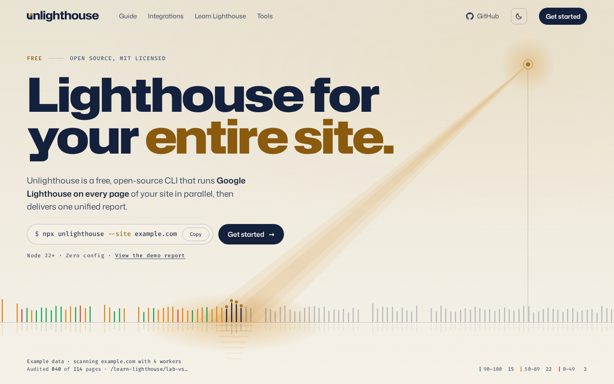
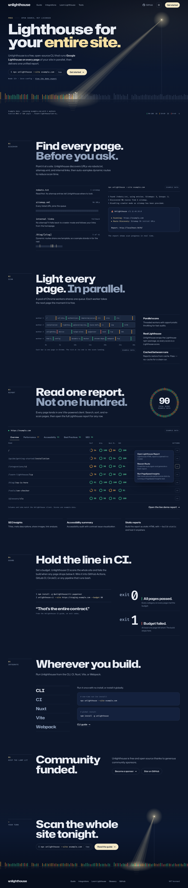
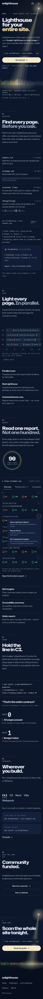
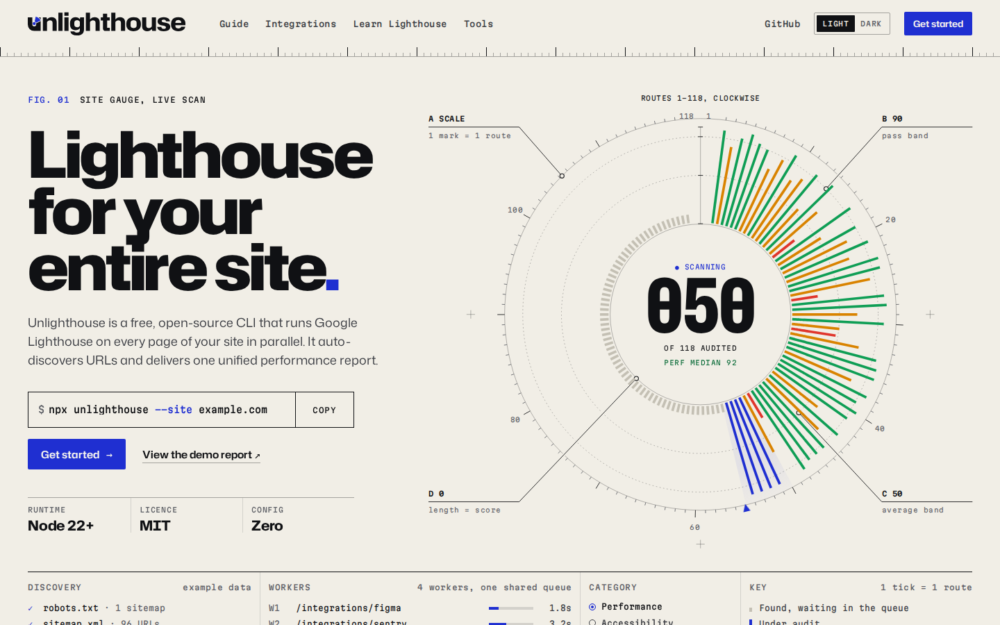
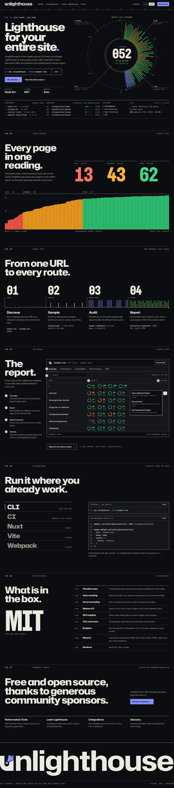
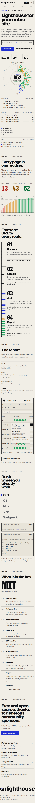

# Unlighthouse redesigns: A and B

Two landing page redesigns, built in parallel from the same brief.
- B has had a polish pass.
- A has not.

Every number on both pages is example data.

## A: Night watch editorial

[`redesign-a.html`](redesign-a.html)

- **Palette:** dark navy with a cream lamp. Light mode is warm paper with a brass lamp.
- **Hero:** a lamp on a mast throws its beam onto a skyline of page ticks. The ticks settle into score colours.
- **Chapters 01 to 06:** find, light, read, CI, integrations, sponsors.
- **Weak spots:**
  - The sponsor section is thin.
  - The brass sits close to the orange score colour.

### Light, first screen

### Dark, full page

### Mobile, dark

## B: Instrument poster (polished)

[`redesign-b.html`](redesign-b.html)

- **Palette:** paper, black ink, ultramarine.
- **Hero:** a large site gauge with dial marks and labelled callouts.
- **Below:** a score barcode, one continuous signal-path rail, the real report, real snippets, and a giant wordmark.

### Light, first screen

### Dark, full page

### Mobile, light

